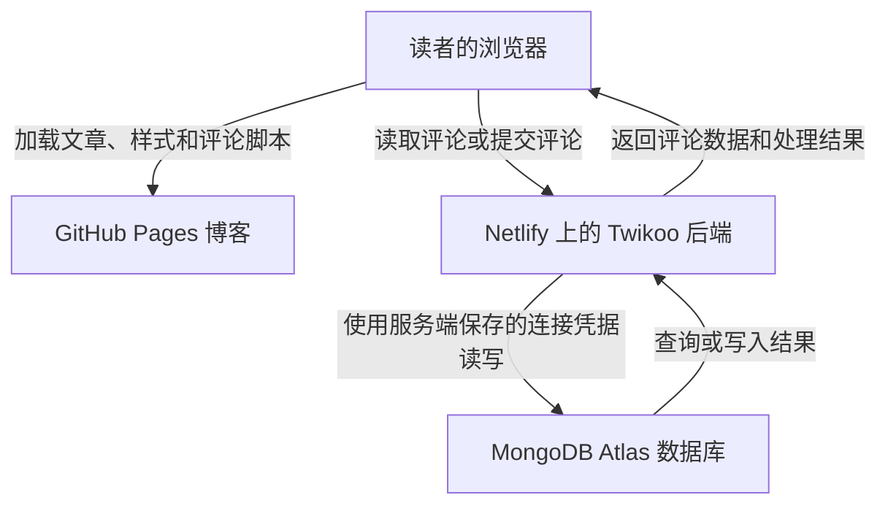

我的博客部署在 GitHub Pages 上，使用 Astro 和 Twilight 主题。是我使用B站up主”Spr_Aachen”的Twilight开源博客模板，这里也是感谢up主开源。

文章底部原本就设有评论框，但是需要自己配置，排查后发现，主题已经准备好了评论区的界面，但没有部署评论后端，也没有配置用于保存评论的数据库。配置文件里是一个示例服务地址。

这篇文章记录我在 **2026 年 11 月 16 日至 17 日**搭建评论系统的过程。方案是：**Twikoo 提供评论功能，Netlify 运行后端，MongoDB Atlas 保存数据，GitHub Pages 继续托管博客。** 本次接入时，Twikoo 前后端版本均为 **2.0.17**。

文中的截图来自实际操作。数据库密码、完整的数据库连接凭据，以及包含邮箱等信息的截图没有放入文章。服务控制台的名称和界面以后可能变化，操作时应结合当时的官方文档。

## 一、评论框为什么能显示，却不能发送？

浏览器可以直接显示 HTML、CSS 和 JavaScript，所以只要主题带有评论组件，就可能看到昵称、邮箱、输入框和发送按钮。

但评论需要保存到所有读者都能访问的地方。仅有输入框，还缺少接收请求、检查内容、写入数据库和读取历史评论的服务。

GitHub Pages 本身是静态网站托管服务，适合发布构建后的网页文件；它没有替这个博客运行一个处理评论写入的后端。关于静态托管的定位，可以参考 [GitHub Pages 官方介绍](https://docs.github.com/en/pages/getting-started-with-github-pages/what-is-github-pages)。

因此，处理这个问题需要把博客中的评论组件连接到一个实际可用的评论服务。

## 二、Twikoo、Netlify 和 MongoDB Atlas 分别负责什么？

这里所需要的工具有这些，大家初次接触可以按下面的分工理解。

| 名称 | 在这套方案中的角色 | 需要做什么 |
| --- | --- | --- |
| Twikoo | 一套评论系统，包含浏览器端组件和服务端程序 | 部署服务端，再把地址填进博客 |
| Netlify | 云部署平台，本次用它的 Functions 运行 Twikoo 后端 | 导入后端仓库、配置环境变量、部署 |
| MongoDB Atlas | 托管 MongoDB 数据库的云服务 | 创建数据库部署、数据库用户和访问规则 |
| GitHub | 保存博客源码和评论后端部署代码 | 维护两个用途不同的仓库 |
| GitHub Pages | 托管博客构建后的静态网页 | 发布文章和前端配置 |

这次大部分步骤都在网页控制台完成，不要求先在电脑上安装 MongoDB 数据库，也不要求通过命令行管理 Netlify。

访问和发表评论的大致过程如下：



数据库用户名和密码保存在 Netlify 的服务端环境变量中。博客前端只需要知道 Twikoo 的公开接口地址，浏览器不会直接拿着数据库密码连接 Atlas。

## 三、先准备好账号和部署顺序

这套方案需要 GitHub、MongoDB Atlas 和 Netlify 三个账号。本次选择 Atlas 的 Free 部署，并使用 Netlify 免费方案中的资源。免费方案仍有容量、调用量和其他限制，后续应以自己的控制台和账单页面为准。

实际操作按这个顺序进行：

1. 在 Atlas 创建数据库部署，获得连接字符串。
2. 配置数据库用户和网络访问权限。
3. 将 Twikoo 的 Netlify 部署仓库 Fork 到自己的 GitHub 账号。
4. 在 Netlify 导入该仓库，设置数据库环境变量并部署。
5. 检查云函数地址能否公开访问。
6. 修改博客评论配置，发布博客更新。
7. 在评论区设置管理员密码，并完成真实评论测试。

## 四、在 MongoDB Atlas 创建数据库

### 1. 选择 Free 部署

进入 Atlas 的创建页面后，选择 **Free**。截图中我填写的名称是 `FamousPig-Blog`，Free 卡片显示的存储容量是 512 MB。

云厂商和地区可以结合当时可选项选择。截图中的 AWS、Tokyo 是创建页面当时的选择，不是其他人必须照抄的参数。


*图 1：确认选择的是 Free，再点击右下角的 Create Deployment。*

`Preload sample dataset` 表示预载示例数据，这不是评论系统必需的内容，可以取消。`Automate security setup` 会帮助完成部分初始设置，但创建后仍要检查数据库账号和网络规则。

### 2. 保存数据库用户凭据

创建过程中，Atlas 可能自动生成数据库用户名和密码，也可以在 **Database Users** 中管理用户。这里的数据库用户，与登录 Atlas 网站的账号是不同的。

需要安全保存数据库用户名和密码，并确认该用户拥有评论数据库所需的读写权限。公开教程和截图中不要展示密码；如果密码已经出现在公开位置，应修改密码，并同步更新使用它的环境变量。

本次 Atlas 的自动设置页面提供了数据库凭据。那张截图包含密码，因此没有收录在本文中。

### 3. 获取数据库连接字符串

在部署的 **Connect** 向导里，选择 **Drivers and Client Libraries**。


*图 2：选择应用程序驱动连接方式，获取后端需要的连接字符串。*

下一步选择 **JavaScript** 和 **Node.js Driver**，复制页面提供的连接字符串。


*图 3：这里显示的是带占位符的 URI，需要替换为自己的数据库用户名和密码。*

字符串一般类似下面的形式。此处全部使用示例占位符：

```text
mongodb+srv://<db_username>:<db_password>@<your-cluster-host>/
```

将 `<db_username>` 和 `<db_password>` 替换成数据库用户的真实凭据，替换后不要保留尖括号。如果密码包含 URI 中有特殊含义的字符，需要按 Atlas 提示进行 URL 编码；也不要把整条 URI 一起编码。

连接字符串准备好后，点击 **Done** 返回控制台。这个按钮只是结束连接向导，后面仍需配置网络权限，并部署使用这条连接字符串的程序。

## 五、允许 Netlify 后端访问数据库

Atlas 的数据库网络访问由 IP Access List 控制，只有匹配列表规则的来源才能尝试连接。只添加自己电脑的当前 IP，并不能代表部署在 Netlify 的函数也能访问。规则的含义可参考 [Atlas IP 访问列表文档](https://www.mongodb.com/docs/atlas/security/ip-access-list/)。

在本次界面中，入口是：

```text
Database & Network Access → IP Access List → Add IP Address
```

本次为了让没有固定出口 IP 的 Netlify 后端连接 Atlas，添加了下面的规则：

| 字段 | 本次填写内容 |
| --- | --- |
| Access List Entry | `0.0.0.0/0` |
| Comment | `Twikoo-Netlify` |
| 临时规则开关 | 关闭，避免到期后评论突然无法访问数据库 |


*图 4：填写规则后点击 Confirm，并等待规则状态变为 Active。*

**`0.0.0.0/0` 表示允许所有 IPv4 来源尝试连接，网络范围很宽。** 它不会取消数据库的用户名和密码验证，但也意味着不能再依赖来源 IP 限制来保护数据库。应使用强密码，并限制数据库用户权限；如果以后具备固定出口 IP 等条件，应收紧规则。

## 六、准备 Twikoo 的 Netlify 部署仓库

打开官方的 [twikoojs/twikoo-netlify 仓库](https://github.com/twikoojs/twikoo-netlify)，点击 **Fork**，复制到自己的 GitHub 账号下。

我的账号中得到的仓库是：

```text
Famous-Pig/twikoo-netlify
```

此时 GitHub 中有两个不同用途的仓库：

| 仓库 | 主要内容 | 发布位置 |
| --- | --- | --- |
| `Famous-Pig.github.io` | 文章、主题、页面和前端配置 | GitHub Pages |
| `twikoo-netlify` | Twikoo 后端部署入口和依赖配置 | Netlify |

给 Netlify 导入的是后端仓库。完整的数据库连接字符串应保存在 Netlify 环境变量里，不能写进这两个公开仓库。

## 七、在 Netlify 导入仓库并完成授权

### 1. 通过 GitHub 导入

登录 Netlify 后，进入创建项目页面，找到 **Import a Git repository**，选择 **GitHub**。

首次连接时，GitHub 会要求安装或配置 Netlify App。本次选择 **Only select repositories**，只授权 `twikoo-netlify` 仓库。


*图 5：核对账号和仓库后点击 Install，不需要为了这个评论服务授权所有仓库。*

安装过程中还可能出现 GitHub 的 **Confirm access** 页面。这属于账号身份确认，按页面提供的 GitHub Mobile 或密码方式由自己完成即可，密码和验证码不应提供给别人。

### 2. 遇到 No repositories found 怎么办？

我在授权后遇到了 Netlify 仓库列表为空的问题，页面显示 **No repositories found**。


*图 6：仓库列表为空时，页面提供了 Configure Netlify on GitHub 入口。*

可以先点击该入口，检查当前登录的 GitHub 账号，以及 Netlify App 是否获得了目标仓库的访问权限。


*图 7：本次检查时，目标仓库已经在 Repository access 列表中。*

如果改动了仓库授权，保存后再回到 Netlify。我这次在确认权限后刷新了页面，并重新从 **Import a Git repository → GitHub** 进入导入流程，随后才成功选到仓库。

这个现象不能一概认定为仓库没有创建成功，也不要因此盲目扩大到所有仓库的权限。先核对账号、授权范围，再重新进入导入流程。

## 八、配置 Netlify 项目和数据库环境变量

选中 `twikoo-netlify` 后，会进入配置确认页面。


*图 8：这是点击部署前的配置页面；数据库环境变量的实际值不在截图中。*

本次使用该仓库时，配置如下：

| 配置项 | 本次设置 |
| --- | --- |
| Project name | `famouspig-twikoo`，其他人应填写自己可用的名称 |
| Branch to deploy | `main` |
| Base directory | 留空 |
| Build command | 留空 |
| Publish directory | 留空 |
| Functions directory | `netlify/functions` |

这张表针对本次使用的 Twikoo 部署仓库。如果仓库模板以后调整，应以其说明和配置文件为准，不能把 Astro 博客的构建命令直接套用到这个后端仓库。

接着点击 **Add environment variables → New variable**，添加：

```text
Key:   MONGODB_URI
Value: 已替换好用户名和密码的完整数据库连接字符串
```

变量名需要准确写成 `MONGODB_URI`。值不能带有未替换的 `<db_username>`、`<db_password>`，也不要额外加引号。

如果当前控制台支持选择变量作用范围，应确保它对生产环境的 Functions 运行时可用。变量应通过 Netlify 控制台等服务端配置方式保存；有关作用范围和管理方法，可参考 [Netlify 环境变量文档](https://docs.netlify.com/build/environment-variables/get-started/)。

配置完成后点击 **Deploy twikoo-netlify**。如果在首次部署后才添加或修改环境变量，需要重新部署，使新部署使用更新后的配置。本方案的官方步骤也可对照 [Twikoo 的 Netlify 部署说明](https://twikoo.js.org/backend.html#netlify-%E9%83%A8%E7%BD%B2)。

## 九、等待部署完成，并检查公开访问

### 1. Building 变为 Published

点击部署后，Netlify 会拉取仓库、安装依赖并部署函数。页面先显示 **Building**，成功后变为 **Published**。


*图 9：构建已成功发布，但截图中项目名称旁仍有 Private 标记，还要继续检查访问限制。*

本次项目域名是：

```text
https://famouspig-twikoo.netlify.app
```

### 2. Published 后仍可能无法让读者访问

我这次的项目发布后仍显示 **Private**。检查接口时，访问被要求登录，普通读者自然也无法通过它加载或发送评论。

因此，我在项目页面点击 **Make public**，确认生产项目的访问对象为任何互联网上的人，然后点击“公开”。


*图 10：公开的是需要供读者调用的生产服务，不是在公开数据库密码。*

不同账号和套餐的界面可能不同，并非每个新项目都要重复这个操作。判断标准是：**未登录 Netlify 的普通访客，也能访问生产评论接口，而不会被重定向到登录页。**

### 3. 打开完整的云函数地址

本次实际使用的接口地址是：

```text
https://famouspig-twikoo.netlify.app/.netlify/functions/twikoo
```

这里需要保留 `/.netlify/functions/twikoo` 后缀。其他人部署时，把前面的域名换成自己的项目域名。

打开后，页面返回了 JSON，其中包含“Twikoo 云函数运行正常”，版本号为 `2.0.17`。


*图 11：这个响应说明公开的函数入口已经可以访问。*

需要区分几个检查阶段：**函数入口可访问、数据库可连接、评论可读取、评论可写入**。看到这段运行提示后，还要接上博客前端，并完成实际发送和刷新读取测试。

## 十、把 Twikoo 地址填入博客

### 1. 修改 Twilight 配置

在我的博客中，配置入口是项目根目录的 `twilight.config.yaml`。将原先的示例地址替换成自己的完整云函数地址：

```yaml
post:
    comment:
        enable: true
        twikoo:
            envId: "https://famouspig-twikoo.netlify.app/.netlify/functions/twikoo"
            lang: "en"
```

上面保留了本次博客原有的 `lang: "en"`，因此它代表评论界面语言，而不是数据库或部署地区。若要改成中文，应结合所用版本的语言资源配置处理。

这段代码展示的是相关配置的层级。修改现有文件时，应替换对应字段，不要再额外复制出第二个 `post:` 配置块。

还要确认文章本身没有关闭评论，例如文章头部若有 `comment: false`，该文章不会显示评论区。

### 2. 同步更新浏览器端 Twikoo

这次检查发现，主题原来引用的 Twikoo 客户端是 `1.6.9`，新部署的后端则是 `2.0.17`。我将客户端也更新为 `2.0.17`，并使用随博客一起发布的静态脚本：

```text
public/assets/js/twikoo-2.0.17.min.js
```

该文件来自对应版本的官方 npm 包。本次使用的是适合非腾讯云部署的精简客户端。脚本类型、版本锁定及初始化参数的说明可参考 [Twikoo 前端部署文档](https://twikoo.js.org/frontend.html)。

对于没有现成评论组件的网页，初始化的核心关系如下。这只是帮助理解的示例，现有主题中不应再重复添加一套评论组件：

```html
<div id="tcomment"></div>
<script src="https://cdn.jsdelivr.net/npm/twikoo@2.0.17/dist/twikoo.min.js"></script>
<script>
  twikoo.init({
    envId: "https://你的项目名.netlify.app/.netlify/functions/twikoo",
    el: "#tcomment",
    path: location.pathname
  });
</script>
```

其中，`envId` 决定请求发往哪个后端，`el` 指定评论区容器，`path` 用于区分文章。文章路径如果日后改变，旧评论也需要按路径映射关系考虑迁移。

### 3. 处理文章切换时的初始化

我的主题使用 Swup 切换页面，站内跳转时并不总是发生完整页面刷新。因此还需要让评论组件在进入另一篇文章时，挂载到新的容器并使用新文章的路径。

本次把相关逻辑整理到 `src/plugins/comments.ts`，主要处理了三个行为：

- 同一篇文章收到重复的页面加载事件时，不重复初始化，避免清空正在输入的内容。
- 切换到另一篇文章时，使用新文章的评论容器和路径。
- 脚本尚未加载完成就发生跳转时，跳过已经离开页面的旧容器。

## 十一、发布博客配置更新

在 Netlify 上部署成功后，还需要发布博客前端的修改。只改本地文件，线上 GitHub Pages 不会自动获得本地的新配置。

确认需要提交的改动后，可以使用 Git 提交和推送。本次接入涉及的文件可以明确指定：

```bash
git status
git add twilight.config.yaml src/components/post/twikoo.astro src/plugins/comments.ts public/assets/js/twikoo-2.0.17.min.js tests/comments.test.cjs
git commit -m "Connect blog comments to Twikoo Netlify and update client"
git push origin main
```

这条 `git add` 针对本次实际修改的文件。其他人的主题结构可能不同，应先用 `git status` 核对自己的改动。

我的仓库在推送到 `main` 后，会触发 **Deploy to GitHub Pages** 工作流，完成 Astro 构建并发布网页。需要到 GitHub 的 **Actions** 页面确认部署成功，再打开线上文章检查。

这里有两条发布流程：博客仓库更新触发 GitHub Pages 发布，Twikoo 后端仓库更新触发 Netlify 部署。平时发布文章通常只走前一条流程。

## 十二、设置管理员密码并完成评论测试

前端上线后，进入一篇开启评论的文章，按 **Ctrl + Shift + R** 刷新，再滚动到评论区。

首次管理时，点击评论区的齿轮入口，按提示设置管理员密码。这个密码用于管理评论，与 Atlas 数据库密码、GitHub 密码、Netlify 登录密码分别承担不同用途。

随后做一次完整测试：

1. 填写昵称、邮箱和一条测试评论，点击发送。
2. 如果配置了审核，进入管理界面检查评论状态。
3. 刷新页面，确认评论能够再次加载。
4. 换一个浏览器或无痕窗口，检查普通访客能否看到已公开的评论。
5. 进入另一篇文章，确认不同文章的评论没有混在一起。

**截至这次接入记录，博客构建和相关自动检查已通过，GitHub Pages 部署成功，线上文章也已引用新的接口地址和客户端。管理员首次设置与真实发表评论，仍是需要由站长完成的最后验证步骤。** 本文没有把“函数运行正常”的截图当成已完成评论写入测试的证明。

## 十三、评论到底保存在哪里，会不会丢失？

这套方案把不同数据放在不同的位置：

| 内容 | 保存位置 |
| --- | --- |
| 文章 Markdown、主题和前端配置 | 博客的 GitHub 仓库及本地副本 |
| Twikoo 后端部署代码 | `twikoo-netlify` 仓库 |
| 完整数据库连接凭据 | Netlify 服务端环境变量 |
| 评论记录和服务端配置 | 连接字符串指向的 MongoDB Atlas 数据库 |
| 管理员密码等敏感信息 | 按各服务提供的方式自行保管 |

因此，重新构建博客、修改头像或发布一篇新文章，通常不会删除数据库里的评论。重新部署 Twikoo 后端，只要仍连接到原数据库，也不应因为替换函数代码而清空评论。

但托管数据库并不等于永远不会丢失。误删数据库、误操作评论、账号或服务异常，以及迁移时遗漏数据，都可能带来损失。GitHub 上的博客源码备份也不包含这些在线评论。

后续维护时应定期备份评论数据，并确认备份能够恢复。可先查看当前 Twikoo 管理界面的导入导出功能；需要更完整的数据库备份时，再根据 Atlas 当前支持的方式制定方案。备份文件可能包含邮箱等信息，应妥善保存。

迁移平台前，除了代码和数据库，还要记录评论后端地址、数据库连接配置、文章路径及相关管理设置。保留文章路径关系，可以减少迁移后“评论还在数据库中，文章却读不到”的问题。

## 十四、以后出问题时，从哪里开始检查？

| 现象 | 优先检查的地方 |
| --- | --- |
| 评论框有界面，但发送失败 | `envId` 是否仍为示例地址；接口、数据库是否可访问；具体错误信息 |
| Netlify 显示 No repositories found | 当前 GitHub 账号、Netlify App 的仓库授权、重新进入导入流程 |
| 已 Published，却跳转到登录页面 | 生产项目是否受私有访问限制，未登录访客能否访问接口 |
| 云函数提示运行正常，但数据库操作失败 | `MONGODB_URI`、数据库账号权限、Atlas IP 访问规则和函数日志 |
| 修改配置后线上没有变化 | 是否推送了正确分支、GitHub Actions 是否成功、浏览器是否仍使用旧资源 |
| 页面切换后评论消失或串页 | 初始化时机、文章 `path`、前端脚本与后端版本 |
| 只有某一篇文章没有评论区 | 该文章是否设置了 `comment: false` |
| 评论发送后暂时看不到 | 返回结果、审核设置、管理界面中的评论状态 |

排查时可以先打开云函数地址，确认是否能公开访问；再检查 Netlify 的函数日志和 Atlas 的网络、账号配置；最后核对博客前端的接口地址与文章路径。日志、截图和求助信息中都应去掉密码、完整连接凭据和令牌。

本次部署用到的主要官方资料是 [Twikoo Netlify 部署说明](https://twikoo.js.org/backend.html#netlify-%E9%83%A8%E7%BD%B2)、[Twikoo 前端配置](https://twikoo.js.org/frontend.html)、[Atlas 网络访问文档](https://www.mongodb.com/docs/atlas/security/ip-access-list/)和 [Netlify 环境变量文档](https://docs.netlify.com/build/environment-variables/get-started/)。重新部署或升级前，可以先对照这些资料检查界面和参数是否有变化。
